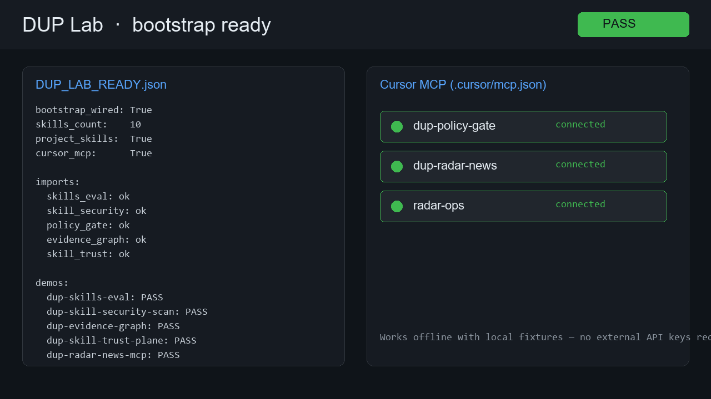
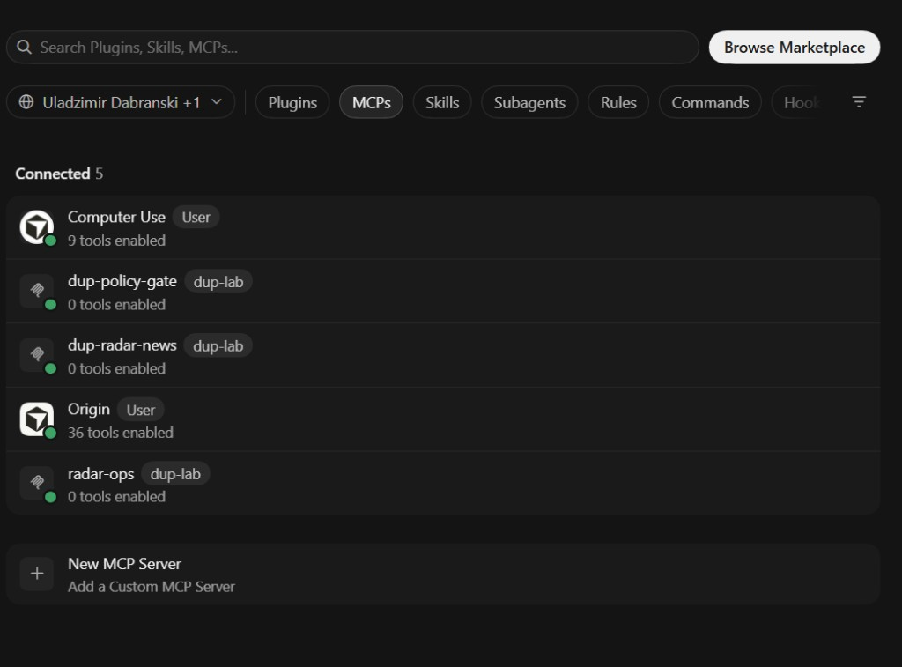

# DUP Lab — start here

[](https://github.com/Gruver87/dup-lab/actions/workflows/ci.yml)
[](https://github.com/Gruver87/dup-lab/releases)

**Org:** [DUP Labs](https://github.com/Gruver87) · **Author:** Uladzimir Dabranski  

One-command onboarding for the Agent Skills / MCP / trust stack.  
Works offline with local fixtures — **no external API keys required**.

```text
clone → make bootstrap → open in Cursor → skills + MCP already wired
```





> After `make bootstrap`: green `DUP_LAB_READY.json` + `dup-policy-gate` / `dup-radar-news` / `radar-ops` connected in Cursor (project `dup-lab`).

## Quick start

```bash
git clone https://github.com/Gruver87/dup-lab.git
cd dup-lab
make bootstrap
# Windows: .\scripts\bootstrap.ps1
```

What bootstrap does automatically:

1. Finds or **clones** sibling repos into `vendor/`
2. `pip install -e` trust / guardrail packages
3. Installs Agent Skills into project + user skill dirs (Cursor auto-loads)
4. Writes `.cursor/mcp.json`
5. Runs fixture demos and writes `DUP_LAB_READY.json`

Then open the `dup-lab` folder in Cursor (or `dup-lab.code-workspace`) and reload once if MCP servers do not appear.

Verify anytime:

```bash
.\scripts\verify.ps1    # or: make verify
```

## Architecture

```text
Execution     agent skills pack · optional domain MCP
Guardrails    policy-gate · skill-security-scan
Trust         skills-eval · evidence-graph · skill-trust-plane
```

Domain combat stands (e.g. crypto market ops) are documented separately — see [`docs/CRYPTO_STAND.md`](docs/CRYPTO_STAND.md).  
L1 protocol evidence stays a **separate** tree — skill `l1-boundary`.

## Commands

| Command | Purpose |
|---------|---------|
| `make bootstrap` / `.\scripts\bootstrap.ps1` | Full auto wiring |
| `.\scripts\verify.ps1` / `make verify` | Self-check |
| `make doctor` | Print last `DUP_LAB_READY.json` |
| `make demos` | Re-run fixture demos |
| `make promo` / `python scripts/promo_teaser.py` | README → ~30s teaser |

## Honesty

- Bootstrap PASS ≠ long soak / production claim  
- Fixture demos need no external credentials  
- Claims still require packs on disk when you assert readiness elsewhere  

## Promo

Generate a **~30s TikTok / Reels teaser** from this README via
[`dup-content-engine`](https://github.com/Gruver87/dup-content-engine):

```bash
# sibling clone: ../dup-content-engine
python scripts/promo_teaser.py
# offline TTS:
python scripts/promo_teaser.py --offline-tts
# or: make promo
```

Artifacts land in `out/promo/` (+ `export/` drop folder). Upload the mp4 **manually**.  
Gate `ALLOW` ≠ audience growth. Full guide: [`docs/PROMO.md`](docs/PROMO.md).

## Related

| Repo | Role |
|------|------|
| [`dup-agent-skills`](https://github.com/Gruver87/dup-agent-skills) | Skills pack source |
| [`dup-skill-trust-plane`](https://github.com/Gruver87/dup-skill-trust-plane) | Control plane |
| [`dup-skills-eval`](https://github.com/Gruver87/dup-skills-eval) | Eval gate |
| [`dup-content-engine`](https://github.com/Gruver87/dup-content-engine) | Fail-closed Shorts / teaser pipeline |
| Profile | [github.com/Gruver87](https://github.com/Gruver87) |

## License

MIT — [`LICENSE`](LICENSE).
